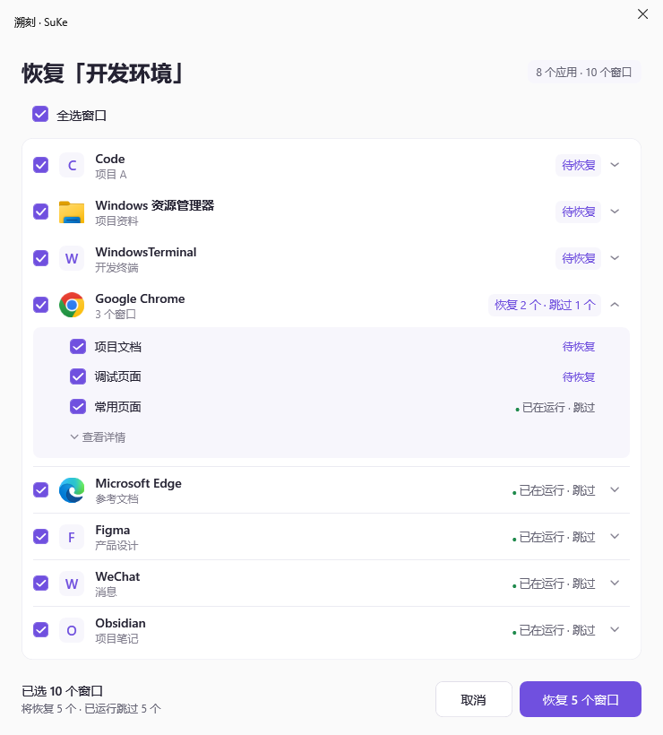
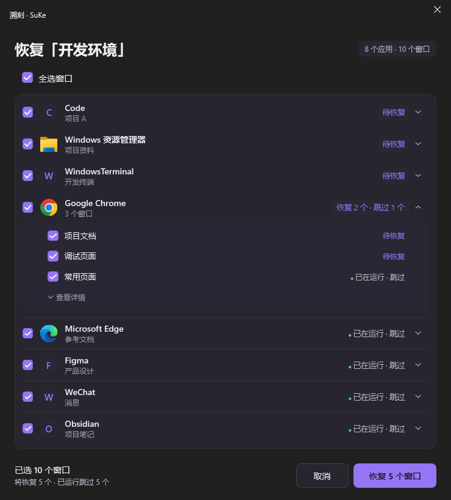
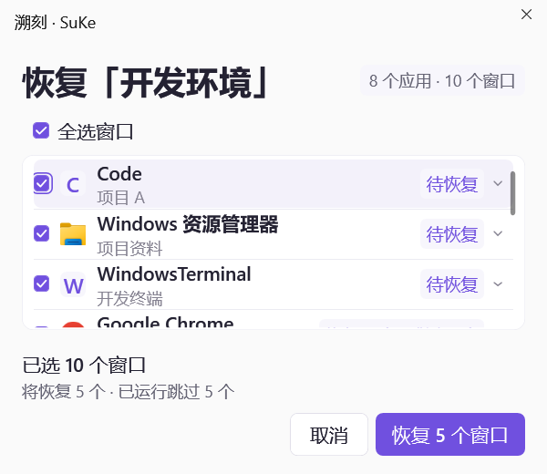

# 恢复弹窗视觉优化验收

日期：2026-10-17。

## 范围与步骤

本轮在现有应用分组恢复弹窗上改善视觉，不改变窗口匹配、恢复计划、跳过已运行窗口和结果记录语义。

| 步骤 | 内容 | 结果 |
| --- | --- | --- |
| P1 | 局部控件样式、窗口比例、标题与列表排版、图标及留白 | 定向15/15通过，浅/深色真实WPF渲染已核对 |
| P2 | 列表对齐、状态、键盘焦点及底栏响应式排版 | 定向36/36通过，含最小窗口与150%字号布局约束 |
| P3 | 完整回归、截图、最终构建与入口检查 | 已执行；514通过、1跳过、1项既有失败，最终入口启动成功 |

## P1

- 窗口默认宽740，高度最多820 DIP并限制在可用屏幕内；应用行从34增加到50 DIP，图标20→28，副文字10.5→12。
- 新增仅供该弹窗使用的 `RestorePlanPreviewStyles.xaml`，统一18 DIP复选框、紫色主按钮、次按钮和轻量展开按钮。提供悬停、按下、禁用和键盘焦点状态，不更改全局控件样式。
- 标题与底栏外的应用列表使用独立浅/深色表面、圆角和轻分隔线，减少原有表格般的拥挤感。
- 无障碍名称在创建控件时明确本地化，独立WPF宿主不再依赖应用级Loaded本地化挂钩。
- `RestoreSelectionUiTests` 与 `RestorePlanPreviewTests`：15通过、0失败；构建0错误，存在NuGet漏洞源不可达的NU1900警告。

## P2

- 应用行与子窗口标题对齐；待恢复状态使用轻紫色，已运行仅保留绿色小点和灰字。应用名称、窗口标题和工作区标题支持完整提示。
- 底栏改为“已选窗口数”与“恢复/跳过摘要”两层，同时保留完整无障碍描述。宽度不足时按钮另起一行，布局取决于实际按钮宽度和文字大小。
- 展开按钮可用键盘聚焦，应用名称区域也可点击展开；子窗口补充行内悬停反馈。深色主按钮使用深色文字，改善浅紫背景的对比。
- 需要处理的提示采用受约束的网格换行，避免长原因撑出弹窗。
- 36项回归通过：分组/全选、跳过策略、结果文案、4组宽度/高度/字号布局。覆盖740×820与600×520、100%与150%文字、长标题、固定操作区、选择统计和按钮不重叠。
- 补强原有模态审批测试：原测试在窗口已Loaded后才注册回调，实际未执行审批断言；现改为真正ShowDialog、通过控件Toggle改变选择、点击确认并检查批准计划。状态含Run时读取真实文本范围，未降低断言。

## 验证方式

- 测试与渲染使用隔离计划，不操作真实工作区。
- 独立WPF宿主创建真实 `RestorePlanPreviewDialog`，从既有8应用/10窗口示例计划渲染，不使用HTML或生图替代实际产品。
- 测试构建位于本地 `artifacts/restore-preview-polish`，临时MSBuild覆盖构建后的根目录复制，保护正在运行的旧实例。测试宿主沿用DLL方式运行，避免生成EXE的低完整性标签造成父进程监控失败。
- 初始未跟踪的 `.sentry-native/` 保持原状；本地工程笔记按既有忽略规则维护。

## 整体结果

- 完整回归：**514通过、1跳过、1失败，共516项**。唯一失败仍为 `ShellUiTests.Real_wpf_shell_displays_live_screen_previews_and_preserves_workflows_in_isolated_storage` 的既有 `App.xaml` BAML测试宿主问题；该宿主本轮未改，未忽略失败。
- 跳过项为需要显式启用的真实桌面采集测试；本轮未操作真实工作区或真实恢复目标。
- `start-suke.bat --dry-run` 实际执行通过；用户退出旧实例后实际运行正常入口，最终Release构建**0警告0错误**、入口退出码0。新进程PID4308，实际路径为根目录 `SuKe.exe`，进程保持响应。
- 根目录EXE与DLL分别与标准Release输出SHA256一致。EXE：`86D1A062F439AEF3505F8E15E80DCC58CBA97F3E1CC4A771AA37AC8F13D78E51`；DLL：`978959F8032D68DCBDBCEF64C82CD4C20CF55B0AC5CF21D3B8DF38EC29DC0B81`。
- 临时渲染宿主源码、工程、生成输出及MSBuild覆盖目标已清理；保留测试报告、实际程序构建和下列渲染截图。

## 实际界面截图

下图为隔离示例数据的真实WPF控件渲染，不是生图或HTML示意。

| 浅色740×820 | 深色740×820 |
| --- | --- |
|  |  |

最小窗口600×520、150%文字下，底栏按钮另起一行，列表独立滚动：

## 用户验收

1. 正常退出旧实例，从根目录 `start-suke.bat` 启动最新版本。
2. 打开某个工作区的恢复预览，核对紫色主按钮/复选框、图标和文字层级、已运行状态及展开区域。
3. 操作全选、应用组选择、子窗口选择与展开收起；检查窗口数量和恢复/跳过统计实时更新。
4. 在外观设置中切换浅/深主题和150%字号，重新打开弹窗；缩小弹窗，确认统计与按钮不重叠，主要操作始终可见。
5. 若自行执行真实恢复，检查已运行窗口仍保持现状并跳过；该步骤留给用户真实数据验收，未计为本轮自动通过。

## 修改文件

- `src/SuKe/UI/RestorePlanPreviewDialog.cs`：布局、列表状态、交互与响应式底栏。
- `src/SuKe/UI/RestorePlanPreviewStyles.xaml`：弹窗专用控件样式。
- `src/SuKe/Localization/LocalizationCatalog.cs`：底栏分层文案。
- `tests/SuKe.Tests/RestoreSelectionUiTests.cs`：真实布局约束与模态审批回归。
- 本文及三个 `docs/screenshots/restore-preview-polished-*.png`：验收说明与实际渲染。
